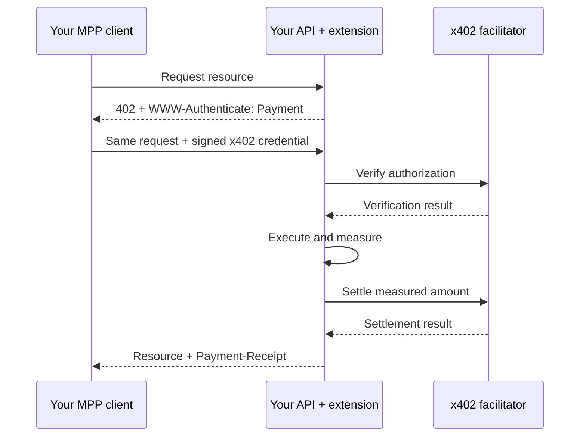

# MPP x402 extensions

Use x402 `upto` and `batch-settlement` payments through the Machine Payments Protocol (MPP). This TypeScript package supplies matching client and server methods. You choose the merchant, facilitator, network, token, signer and storage.

## What you can build

| Method | Use it for | Payment behavior |
| --- | --- | --- |
| `x402/upto` | AI generation, rendering or processing with a cost known after execution | Sign a maximum; settle server-measured usage within that cap. |
| `x402/batch-settlement` | Audio segments, listening checkpoints or repeated API requests | Fund a channel, accept cumulative vouchers, then claim and settle together. |

For music software, generation and listening become payable API operations. An agent can authorize a render budget; a streaming client can pay for successive segments without an onchain transfer for every segment. Your application supplies the audio, usage measurements and access rules.

For Tempo developers, the addition is an MPP interface to these x402 lifecycles. You retain x402 verification and settlement while using MPP challenges, credentials and receipts. A replacement facilitator must support the same scheme, network and proof format.

These custom methods use method `x402` and intents `upto` and `batch-settlement`. Both peers need the implementations. Their identifiers are experimental and unregistered; clients supporting only `tempo/charge` or `tempo/session` will not handle them. MACH redemption and card checkout require their own payment mechanism.

## Install from source

Requires Node.js 22 or newer. Copy this `mpp` directory into your project as `vendor/mpp`, then run from your project root:

```sh
npm --prefix vendor/mpp install
npm --prefix vendor/mpp run build
npm install ./vendor/mpp mppx@0.13.4 @x402/core@2.28.0 @x402/evm@2.28.0 viem@2.57.4
```

The examples import the local package as `mpp-x402`; installation does not depend on an npm release. Shared definitions are at the package root, implementations at `/client` and `/server`. The package is MIT licensed.

Check the facilitator's `/supported` response for x402 v2, scheme and network. Also verify token support, proof format and contract deployments. These EVM examples use Permit2 for `upto` and the official batch scheme for channels. An advertised scheme name alone does not establish proof compatibility.

## Add a metered endpoint

Copy this adapter into your server module. `createUsageHandler` is example application code, not a package export. It returns a handler for Fetch API `Request` and `Response` objects.

```ts
import { HTTPFacilitatorClient, createHandler, createResourceServer, upto } from 'mpp-x402/server';
import type { Store } from 'mpp-x402/server';
import { UptoEvmScheme } from '@x402/evm/upto/server';
import type { FacilitatorConfig } from '@x402/core/server';
import type { Network } from '@x402/core/types';

export type EndpointConfig = {
  facilitator: FacilitatorConfig;
  network: Network;
  recipient: `0x${string}`;
  asset: `0x${string}`;
  assetExtra?: Record<string, unknown>;
  maximum: string;
  resourceUrl: string;
  realm: string;
  namespace: string;
  store: Store.AtomicStore;
};

export async function createUsageHandler(config: EndpointConfig) {
  const facilitator = new HTTPFacilitatorClient(config.facilitator);
  const server = createResourceServer(facilitator, [
    { network: config.network, scheme: new UptoEvmScheme() },
  ]);
  await server.initialize();
  const [requirements] = await server.buildPaymentRequirements({
    scheme: 'upto', network: config.network, payTo: config.recipient,
    price: { asset: config.asset, amount: config.maximum, extra: config.assetExtra ?? {} }, maxTimeoutSeconds: 300,
  });
  if (!requirements) throw new Error('Unsupported payment offer');
  const method = upto({ server, facilitator, store: config.store, namespace: config.namespace });
  return createHandler({ method, offer: { requirements, resource: { url: config.resourceUrl } },
    store: config.store, namespace: config.namespace, realm: config.realm });
}
```

Supply the base URL at `config.facilitator.url`. If authentication is required, `createAuthHeaders` returns headers separately for `supported`, `verify` and `settle`. Use real recipient and token addresses; amounts are integer strings in token base units.

Mount the returned handler at `resourceUrl`. Pass the original URL, method, headers and body; do not consume or change the body first. Here `handle` is the result of `createUsageHandler(config)`, and `render` is your operation:

```ts
export async function POST(request: Request) {
  return handle(request, async () => {
    const result = await render(await request.json());
    return { response: Response.json(result.output), amount: BigInt(result.billedUnits).toString() };
  });
}
```

Compute `billedUnits` from server pricing and measured work. Reject work that could exceed the signed maximum before incurring that cost. Zero usage returns a `no-charge` receipt without a transfer. Failed work does not proceed to settlement; external side effects still need application idempotency.

### Connect the paying client

Supply a connected x402 `ClientEvmSigner`, the same network and its RPC URL. This example allows only the configured recipient and token, with a cap of `50000` base units per payment. For a six-decimal token, that is 0.05 tokens.

```ts
import { x402Client } from '@x402/core/client';
import { UptoEvmScheme } from '@x402/evm/upto/client';
import { createClient, upto } from 'mpp-x402/client';

const cap = '50000';
const core = x402Client.fromConfig({ schemes: [], spendControls: {
  allowedAssets: [{ network, asset, maxAmountPerPayment: cap }],
} }).register(network, new UptoEvmScheme(signer, { rpcUrl }));
core.registerPolicy((_version, offers) => offers.filter(offer =>
  offer.scheme === 'upto' && offer.network === network &&
  offer.asset.toLowerCase() === asset.toLowerCase() &&
  offer.payTo.toLowerCase() === recipient.toLowerCase() && BigInt(offer.amount) <= BigInt(cap),
));
const client = createClient({ methods: [upto({ client: core, networks: [network] })], polyfill: false });
const response = await client.fetch(resourceUrl, {
  method: 'POST', headers: { 'Content-Type': 'application/json' },
  body: JSON.stringify({ prompt: 'Instrumental acid house', seconds: 30 }),
});
if (!response.ok) throw new Error(await response.text());
```

The payer must fund the token and approve Permit2 before using this EVM flow. With your connected `walletClient` and `publicClient`, check allowance and request a bounded approval if needed:

```ts
import { PERMIT2_ADDRESS, getPermit2AllowanceReadParams } from '@x402/evm';
import { encodeFunctionData, erc20Abi } from 'viem';

const approved = await publicClient.readContract(getPermit2AllowanceReadParams({
  tokenAddress: asset, ownerAddress: signer.address,
}));
if (approved < BigInt(cap)) {
  const hash = await walletClient.sendTransaction({ to: asset,
    data: encodeFunctionData({ abi: erc20Abi, functionName: 'approve', args: [PERMIT2_ADDRESS, BigInt(cap)] }),
  });
  const receipt = await publicClient.waitForTransactionReceipt({ hash });
  if (receipt.status !== 'success') throw new Error('Permit2 approval failed');
}
```

Configure both clients for the same account and chain. This allowance is separate from a Compose session approval.



`createClient` retries the challenged request and reconciles its receipt before returning. For browser calls, allow the credential header in CORS and expose `WWW-Authenticate` and `Payment-Receipt`. If you also use Bearer authentication, set `header: 'Payment-Authorization'` in `createHandler`.

## Add batch payments

Reuse `EndpointConfig` above. Here `maximum` is the price of one operation or checkpoint. Keep one scheme instance and channel store per receiver, network and token.

```ts
import { BatchSettlementEvmScheme } from '@x402/evm/batch-settlement/server';
import type { ChannelStorage, AuthorizerSigner } from '@x402/evm/batch-settlement/server';
import { HTTPFacilitatorClient, batch, createHandler, createResourceServer } from 'mpp-x402/server';

export async function createBatchHandler(config: EndpointConfig & {
  channels: ChannelStorage;
  receiverAuthorizerSigner: AuthorizerSigner;
}) {
  const facilitator = new HTTPFacilitatorClient(config.facilitator);
  const scheme = new BatchSettlementEvmScheme(config.recipient, {
    storage: config.channels, receiverAuthorizerSigner: config.receiverAuthorizerSigner,
  });
  const server = createResourceServer(facilitator, [{ network: config.network, scheme }]);
  await server.initialize();
  const [requirements] = await server.buildPaymentRequirements({
    scheme: 'batch-settlement', network: config.network, payTo: config.recipient,
    price: { asset: config.asset, amount: config.maximum, extra: config.assetExtra ?? {} }, maxTimeoutSeconds: 300,
  });
  if (!requirements) throw new Error('Unsupported payment offer');
  const method = batch({ server, facilitator, store: config.store, namespace: config.namespace });
  const handle = createHandler({ method, offer: { requirements, resource: { url: config.resourceUrl } },
    store: config.store, namespace: config.namespace, realm: config.realm });
  return { handle, manager: scheme.createChannelManager(facilitator, config.network, config.asset) };
}
```

Supply a receiver-authorizer signer compatible with the facilitator's advertised authorizer; keep it on the server. For EIP-3009 tokens, set `assetExtra` to their real EIP-712 `name` and `version`. For a supported Permit2 token, set `assetExtra: { assetTransferMethod: 'permit2' }` and confirm its Permit2 allowance.

Replace the client registration with `BatchSettlementEvmScheme` and the MPP `batch` method. Keep the same token, recipient and cap policy, changing its scheme filter to `batch-settlement`:

```ts
import { BatchSettlementEvmScheme, InMemoryClientChannelStorage } from '@x402/evm/batch-settlement/client';
import { Store } from 'mppx';
import { batch, createClient } from 'mpp-x402/client';

const scheme = new BatchSettlementEvmScheme(signer, {
  storage: new InMemoryClientChannelStorage(), payerAuthorizer: signer.address, rpcUrl,
  depositPolicy: { depositMultiplier: 10 },
});
const core = x402Client.fromConfig({ schemes: [], spendControls: {
  allowedAssets: [{ network, asset, maxAmountPerPayment: '50000' }],
} }).register(network, scheme);
// Apply the recipient/asset/cap policy from above, with scheme 'batch-settlement'.
const method = batch({ client: core, networks: [network], receipts: Store.memory() });
const client = createClient({ methods: [method], polyfill: false });
```

The multiplier sizes deposits for several payments, subject to spend caps and minimum deposits. In-memory stores are for local tests. Call `client.fetch` sequentially on one channel and await each response before signing the next voucher. The first receipt reports `funded`; later ones report `accepted`. Neither confirms treasury payment.

Run the returned manager from your server's coordinated settlement job:

```ts
const result = await manager.claimAndSettle();
// result.claims: channel claims. result.settle: transfer to the receiver.
```

The extension does not start this job. `manager.start(policy)` and `manager.stop()` also support scheduling. For continuous audio, protect segments or listening checkpoints with successive vouchers. Your player controls delivery and stopping playback. The generic handler waits for final billing; it does not meter an indefinite open stream.

## State, retries and compatibility

Use durable atomic storage in production: `Store.AtomicStore` for challenges, operations and client receipts; `ChannelStorage` and `ClientChannelStorage` for batch state. Share a stable namespace across routes that must reject reuse of the same proof. Preserve the request URL, body and payment terms when retrying a challenge.

| Response | Your action |
| --- | --- |
| HTTP `204` on a completed retry | Read its receipt. Work was not repeated; store your original output if retries must return it. |
| HTTP `409`, `running` | Check the in-progress operation before retrying. |
| HTTP `503`, `uncertain` | Reconcile the existing payment before creating another charge. |

Inspect uncertain payments with `method.inspect(challengeId)`. After independently confirming the transaction or channel state, record the matching receipt with `method.reconcile(challengeId, receipt)`. This records the result; it does not broadcast or verify a transaction. Keep proof records through the authorization/channel lifetime, including after a challenge expires.

Another network or proof format needs its matching x402 scheme and a `proofKey(payment)` identifying that authorization's replay key. Header conversion cannot make a facilitator accept an unsupported signature or MACH payment. For `exact`, retain the existing `mppx/x402` compatibility implementation alongside these methods.

## Verify your integration

Run from the package directory:

```sh
npm run check
npm test
npm run build
```

The suite uses real EVM authorization builders and validators with simulated contract reads/writes, plus a local HTTP flow. It covers metering, batch deposits/vouchers, claim and settlement, request binding, retries and recovery. Verify contracts, wallet signing and treasury settlement separately on your chosen network.

[MPP custom methods](https://mpp.dev/payment-methods/custom) · [Challenge binding](https://mpp.dev/protocol/challenges) · [mppx source](https://github.com/wevm/mppx) · [x402 source](https://github.com/x402-foundation/x402)
